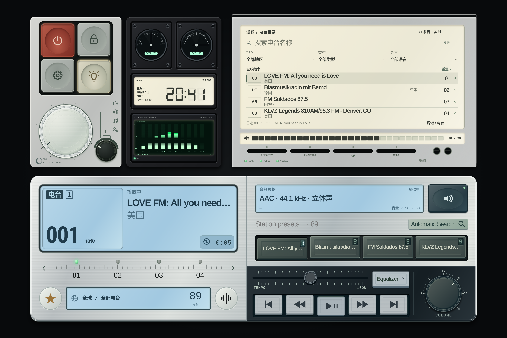
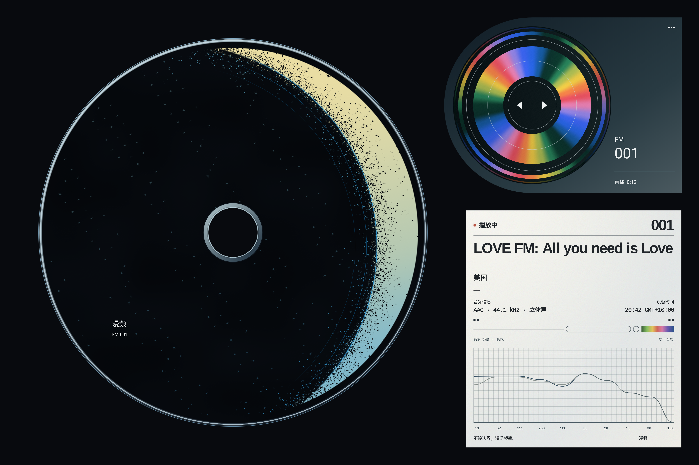

# Public design and tablet adaptation reference

漫频 is a visual listening experience with two native pages. This reference gives contributors the public baseline for Android-tablet adaptations.

## Approved visual references

These are design mock images. Their sample station/programme information illustrates composition; it is not live data or a test result. Current native source defines functional refinements such as album artwork, real PCM spectra, music-library menus and background playback. The images do not authorize adding simulated data to the live app.

## Layout and materials

The baseline uses a **1704 × 1136 logical canvas**, rendered at **3408 × 2272** on the primary tablet. The device page uses silver hardware, restrained printed legends, inset ink displays, raised keys and indexed rotary controls. The immersive page uses a large disc with a compact source/progress component and a separate information/spectrum panel.

For other aspect ratios, preserve the composition and readable control spacing. Propose any necessary inset, scale or layout adaptation explicitly, with before/after screenshots. Keep these constraints:

- Typography is drawn as complete shaped text runs. Preserve Chinese support, long-title handling and readable small labels; never distort glyph widths to fit.
- Counts and units share a centered grid axis. Country codes sit centered in their own boxes, clear of station identity text.
- Selected preset markers light green; unselected and powered-off markers remain gray. Printed metal legends may remain English in the Chinese interface; display content is localized.
- Album sheets use neutral black/white tones and distinct spacing for title, artist, metadata and actions. Long titles can wrap; buttons and close controls remain fully visible.
- The CD uses readable album artwork and falls back to the existing disc artwork when necessary. Do not replace the approved identity or original art in an adaptation.

## Interaction and rendering

The page slide has constant velocity. Ink rendering uses delayed partial updates with a short-lived retained previous frame and periodic full clearing. This is a visual simulation on the tablet display, not a claim that LCD hardware becomes an e-paper panel. Full refresh, partial refresh and the independent front-light ramp serve different purposes; reduced-motion mode bypasses animation and display lag.

Physical controls must respond immediately even while display content settles. Volume uses relative input with no value jump on initial contact. Changed detents drive real sound/haptic feedback. Disc tap toggles playback, clockwise/counterclockwise motion seeks finite local audio, and only the upper-right selector changes tracks by swipe. Background audio belongs to the service, never the Activity lifecycle.

## Source map

| Area | Source |
| --- | --- |
| Canvas scaling, input and page/ink rendering | `android/app/src/main/java/com/aether/radio/AetherView.kt` |
| Native layout nodes and material rendering | `android/app/src/main/java/com/aether/radio/Scene.kt`, `android/app/src/main/assets/scenes/`, `android/app/src/main/assets/skins/` |
| Disc artwork, rotation and compact player | `android/app/src/main/java/com/aether/radio/ImmersivePlayback.kt` |
| Ink settings, About and feedback | `android/app/src/main/java/com/aether/radio/InkSettingsView.kt` |
| Album and music-source sheets | `android/app/src/main/java/com/aether/radio/MusicLibraryDialog.kt`, `MusicSourceDialog.kt` |
| Relative controls and feedback | `android/app/src/main/java/com/aether/radio/RelativeEncoder.kt`, `ControlHaptics.kt`, `ControlSounds.kt` |
| Shared player, background service and widget | `android/app/src/main/java/com/aether/radio/AudioSession.kt`, `PlaybackService.kt`, `MusicWidget.kt` |

Keep approved assets unchanged unless the PR specifically proposes an asset change. Do not copy private design archives into the repository. Follow [CONTRIBUTING.md](CONTRIBUTING.md) for the branch, PR and device-evidence requirements. Visual materials remain covered by [VISUAL-LICENSE.md](VISUAL-LICENSE.md).
