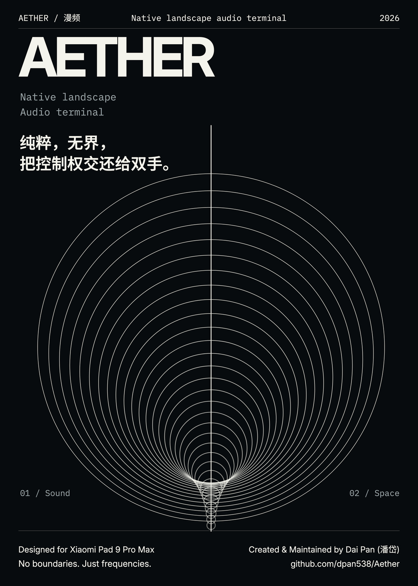
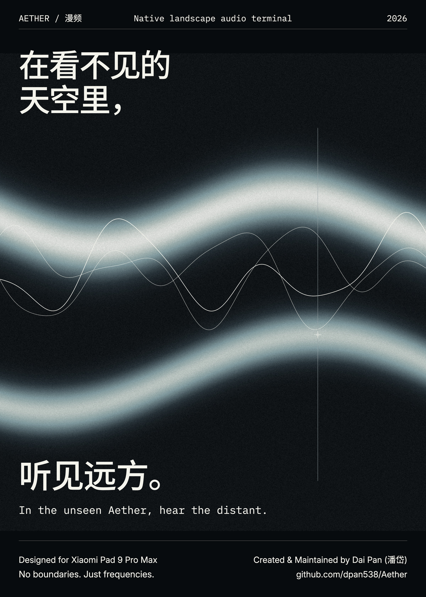
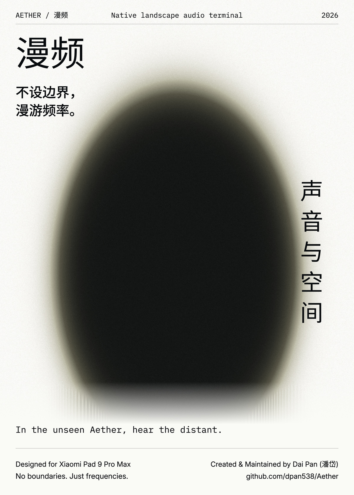
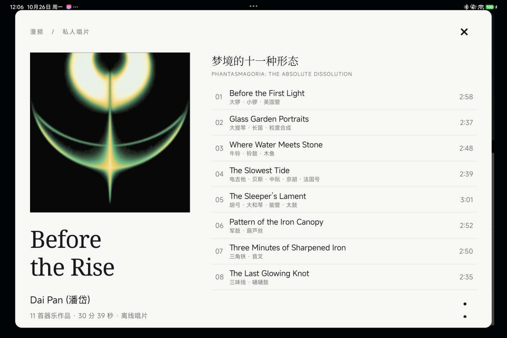

# 漫频

**不设边界，漫游频率。**

**专为小米 Pad 9 Pro Max 横屏打造。** 漫频是一款原生音乐与电台应用，把收音机的实体触感、清晰的声音信息与唱片的视觉体验收进同一块屏幕。

[**下载 Android 预览版 ↗**](https://github.com/dpan538/Aether/releases) · [下载与更新](#下载与更新) · [适配与贡献](CONTRIBUTING.md)

<table>
  <tr>
    <td width="33.33%"></td>
    <td width="33.33%"></td>
    <td width="33.33%"></td>
  </tr>
</table>

## 两种聆听方式

**设备主页**以银灰控制台、墨水屏和实体旋钮组织电台搜索、筛选、预设、播放与音量。让操作有位置，让信息有层次。

**沉浸播放**保留唱片、声音与必要的信息，以更安静的画面陪伴长时间聆听。

**专辑页面**以封面、曲目信息与专辑手记呈现私人唱片。

*以上为界面设计示意图，图中节目与仪表信息用于展示视觉效果。*

## 声音与音乐

- 通过真实电台目录搜索、按地区／类型／语言筛选、收藏与主动随机探索。
- 支持后台播放与系统媒体控制，桌面小组件提供紧凑、横条和大封面唱片卡片三种样式。
- 原生音频播放，支持 50%–150% 速度调整并保持音高，频谱来自实际解码的音频。
- 歌曲可独立星标，收藏电台可立即从四枚预设键调取。
- 支持本地音乐与设备文件导入，附带 Dai Pan（潘岱）的器乐专辑 **Before the Rise**。
- 无广告、推荐信息流、热度榜单或算法个性化。

[独立下载 Before the Rise 专辑](https://github.com/dpan538/Aether/releases/download/v0.1.0-preview.7/Before-the-Rise-Dai-Pan-MP3.zip)：无需安装应用，包含 11 首 MP3、内嵌封面、曲序播放列表和专辑手记。原始音频为 192 kbps / 44.1 kHz 双声道，导出不再次有损压缩。

电台目录来自 [Radio Browser](https://www.radio-browser.info/)。电台的可用性由各自的音源、地区和网络条件决定；应用只播放 HTTPS 音源。

## 下载与更新

项目目前提供 Android 预览版，适配目标为小米 Pad 9 Pro Max 的 **3408 × 2272 横屏**。

[前往下载预览版](https://github.com/dpan538/Aether/releases)

安装后可在应用设置中检查仓库发布的更新。已完成校验的更新文件会保留并复用，覆盖升级保留本地设置。当前公开预览版与持续改进中的源码可能存在功能差异。

## 隐私

聆听不需要账户。电台请求直接连接公共目录与音源；设备音乐通过 Android 文件选择器授权读取。没有麦克风采集、广告跟踪或第三方遥测。

## About

**漫频** — a native listening experience for Xiaomi Pad 9 Pro Max, combining tactile radio controls, local music and an immersive record view.

Aether is the repository and application identifier. The product name is **漫频**.

## 适配与贡献

欢迎为其他安卓平板贡献适配。请先阅读[公开设计与适配参考](ADAPTATION.md)，从当前 `main` 新建分支，完成目标设备验证后提交 PR；主适配目标保持为小米 Pad 9 Pro Max。具体流程见 [CONTRIBUTING.md](CONTRIBUTING.md)。

## 许可证

项目源代码和面向贡献者的技术文档采用 [MIT 许可证](LICENSE)。图标、界面视觉素材、专辑封面与 mock 图采用独立的[视觉素材许可证](VISUAL-LICENSE.md)：仅限为本项目适配、测试和提交 PR 使用，其他复用需 Dai Pan（潘岱）书面许可。音乐录音与专辑文字不属于 MIT 授权范围；第三方字体和依赖保留其[原有许可证](android/third-party/README.md)。
