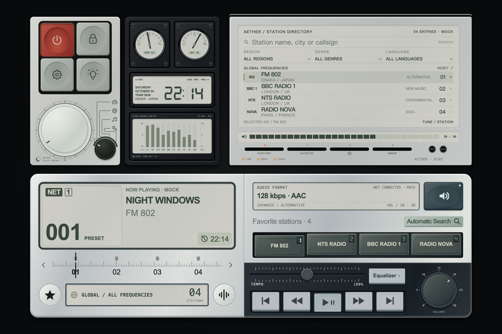
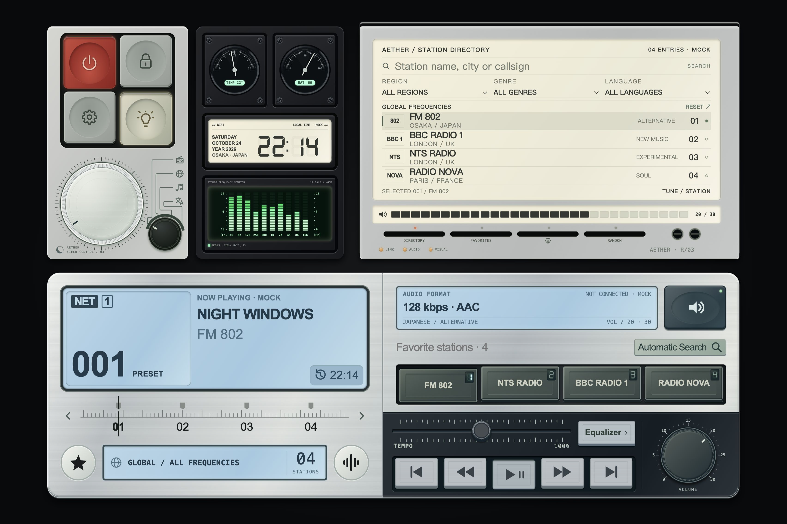
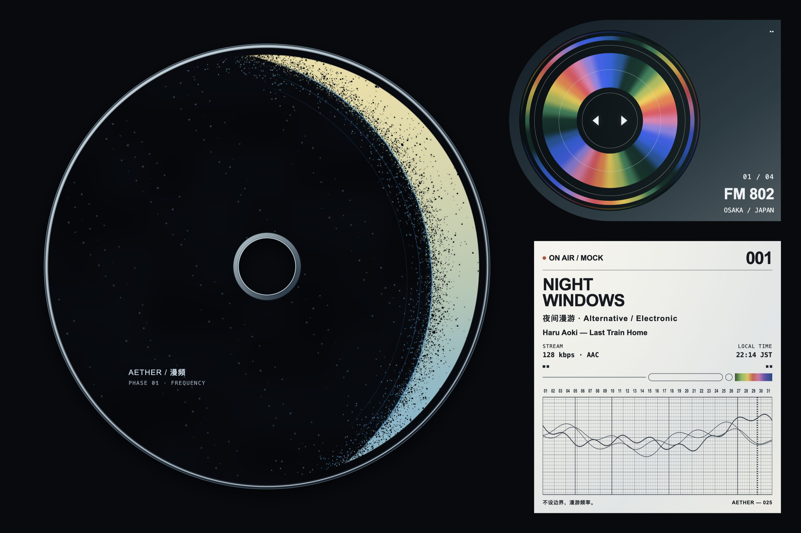

# 漫频 Aether

**不设边界，漫游频率。**
*No boundaries. Just frequencies.*

In the unseen Aether, hear the distant.
（在无形的风波里，听见远方。）

漫频 Aether 专注声音纯粹性与视觉美学。中立索引，无广告、排行榜、信息流或算法推荐；通过搜索、分类、收藏与主动随机调频探索电台。

## 当前状态 · 2026-10-25

用户已确定 **两个页面足够**：现代主页面与纯沉浸页。本轮视觉状态已冻结为 [two-page-baseline](design/snapshots/2026-10-24-two-page-baseline/README.md)，包含可独立运行的源码、3408×2272 参考图、控件局部、浏览器检查记录与 SHA-256 清单，并按用户要求同步仓库备份。早期复古第三页只保留历史参考，不再建设。

**Kotlin Android 应用构建**由单独任务使用 **GPT‑6.1 Sol / Extra High** 执行；以冻结稿逐轮截图对照、叠加和差异检查，包含手势、动画及连续线性动画。实现与验收要求见 [Android 交接书](docs/ANDROID-HANDOFF.md) 和 [动效规格](docs/MOTION-SPEC.md)。

用户已选择 **[E1 双球构图作为临时图标](branding/icons/current/README.md)**：黑底、灰噪圆窗、中央彩球与底部白球，保存本次上传原图及 Android 派生尺寸。最终图标未定稿；用户认为生成图的 AI 感过强，暂停 imagegen。最新按用户提供的 Compose 函数制作 [Canvas Logo 参数预览](branding/icons/2026-10-25-canvas-logo/README.md)：深色底、暖色光核、120 条细白圆环，附 Kotlin 源码与小尺寸对照。此前[圆角图标修订](branding/icons/2026-10-25-axial-icon/README.md)、[黑底色带与白色声波](branding/icons/2026-10-25-spectrum-wave/README.md)、[三组十五张对称渐变研究](branding/icons/2026-10-25-symmetric-gradient/README.md)与[四组十二张黑白／双色研究](branding/icons/2026-10-25-fine-studies/README.md)保留。研究不替换 E1；来源与修订见[品牌记录](branding/README.md)。

**已归档的设计基线是可运行的浏览器视觉原型；Android 工程由独立任务推进，实际构建与验收状态由该任务记录。** 视觉原型四组电台布局样本中的节目、曲目、码率、时钟与仪表均明确标记 MOCK；连接保持 `not-connected`。浏览器检查不代表 Android 或全球电台可播性验收。

## 两页设计

| 页面 | 视觉与操作 |
| --- | --- |
| 现代主页面 · 默认入口 | 银灰设备、默认墨水屏、四枚实体键与双旋钮、目录与统一设置、四枚实体预设、哑光拉丝播放键、Tempo 实体滑块、0–30 音量旋钮 |
| 纯沉浸页 | 月相艺术 CD、石墨蓝灰切台组件、暖灰白信息面板；上下滑动及两枚三角切台；没有菜单、设置或播放按钮 |

两页共用同一电台、播放状态和连接，左右滑动切换。设置位于现代页大屏内，仅有语言、更新检查和 About。小旋钮四维调谐、Tempo 数值及 Equalizer 的功能映射仍为样机提案，不能据此外推真实变速、DSP 或回听能力。

现代页默认墨水态：



点亮态：上屏暖白、下屏冰蓝、仪表绿色，前光约 1.05 秒渐亮。



沉浸页保留已接受的原创月相构图：



## 本地运行与复原

需要 Node.js 22+，无需安装依赖。

```sh
npm run dev
```

- 现代页：`http://127.0.0.1:4176/preview.html?page=modern`
- 沉浸页：`http://127.0.0.1:4176/preview.html?page=immersive`
- 语法检查：`npm run check`
- 校验冻结包：`node scripts/verify-snapshot.mjs`

参考画幅为 3408×2272（3:2），逻辑坐标为 1704×1136。预览按比例缩放。冻结包可在自己的 `source/` 内启动，详见[快照说明](design/snapshots/2026-10-24-two-page-baseline/README.md)。不同浏览器标签是独立示例会话；同一宿主中的两页共享状态。

## 设计与开发文档

| 文档 | 内容 |
| --- | --- |
| [冻结包与状态清单](design/snapshots/2026-10-24-two-page-baseline/README.md) | 原始尺寸图片、复现步骤、源文件和哈希 |
| [Android 交接书](docs/ANDROID-HANDOFF.md) | Kotlin 构建范围、不可偏离的细节、视觉迭代与交付证据 |
| [动效规格](docs/MOTION-SPEC.md) | 点亮、刷新、机械行程、阻尼、连续动画和减弱动态 |
| [现代页规格](docs/MODERN-UI.md) / [沉浸页规格](docs/IMMERSIVE-UI.md) | 具体几何、材质、交互及模拟边界 |
| [视觉方向](design/README.md) / [页面元素](docs/PAGE-ELEMENTS.md) | 当前两页的设计职责 |
| [产品范围](docs/PRODUCT-SCOPE.md) / [体验规划](docs/EXPERIENCE-PLAN.md) | 已提出需求、已实现样机行为与待定问题 |
| [决策记录](docs/DECISIONS.md) | 历史三页方向及最新两页冻结决定 |
| [品牌文案](branding/README.md) / [协作规则](AGENTS.md) | 正式品牌文字与工程约束 |
| [十四张参考原图](design/references/README.md) | 原字节归档；不是应用发布素材 |

```text
branding/                 # 品牌；图标工作在此独立开展
design/modern/            # 现代原型 HTML/CSS/SVG/JS
design/immersive/         # 沉浸原型与圆盘着色器
design/shared/            # 两页共用示例会话
design/snapshots/         # 不可覆盖的源码、渲染与校验基线
design/references/        # 用户授权归档的外部参考原图
docs/                     # 产品、设计、动画与 Android 交接
scripts/                  # 本机预览与快照校验
```

Kotlin 已由用户确定；Compose、Media3 与目录接入的具体实现需在 Android 任务中核对官方资料并验证。尚无签名、商店上架或许可决定。代码和品牌资产的许可方式待确定。

## English

Aether is a radio app shaped around visual craft and personal control. The **modern and immersive views** are the frozen two-page browser baseline with deterministic MOCK data. The earlier retro third page is historical only. A separate task owns Kotlin Android implementation and its screenshot and motion verification. The E1 two-sphere artwork is the user-selected provisional icon; final branding remains undecided, with further generation paused in favor of considering authored geometric design.
