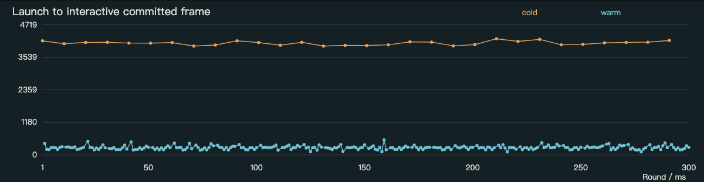
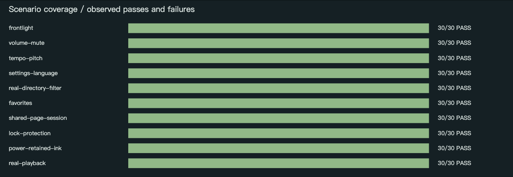
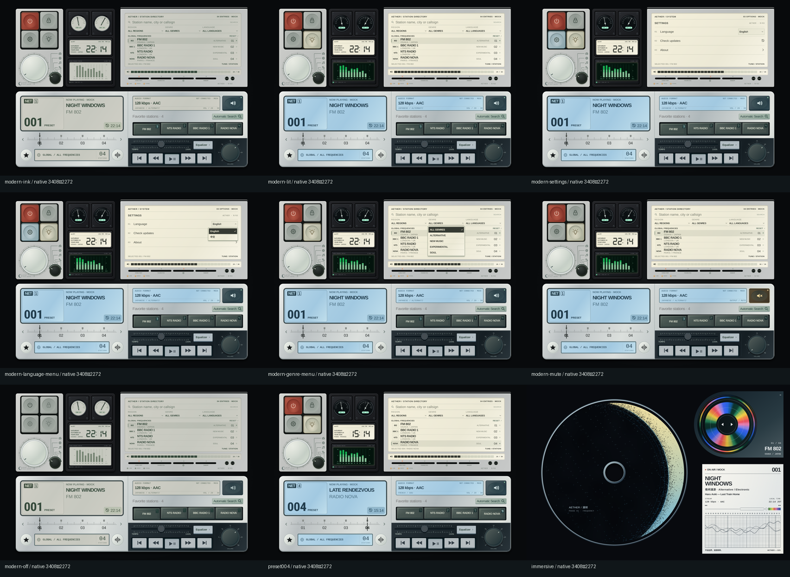

> **验收撤回 · 2026-10-25**：用户实机截图和既有真实播放截图确认文字裁切、排版、频谱及交互缺陷。下方300轮记录是历史状态检查，不能作为视觉或可用性交付通过依据。0.1.0-preview.1 当前存在已知严重问题，正在修复；旧证据保留以说明测试缺口。

# Android delivery and verification

Verified preview: **0.1.0-preview.1**, versionCode **2**, package `io.github.dpan538.aether`. [APK download](https://github.com/dpan538/Aether/releases/download/v0.1.0-preview.1/Aether-0.1.0-preview.1.apk) · [Release](https://github.com/dpan538/Aether/releases/tag/v0.1.0-preview.1) · [Build provenance](BUILD.json).

APK SHA-256: `9f81bbd8977a9a8bf2d354497652c3e75fee95b0a3ef2d3f483e1650d1670810`. The installed APK matched these exact bytes after a real in-app download and Android covering install. This is a preview; physical-tablet acceptance and unknown-defect guarantees are not established.

## 300 actual opens and uses

The formal dataset contains **300 unique completed rounds: 300 passes, 0 failures, 0 crash events, 0 ANR events**. It used 30 process-cold Activity starts and 270 foreground returns on the unchanged, non-debuggable published APK, in real mode at **3408×2272**, density 320. Each of ten scenarios ran 30 times: front light, relative volume/mute, real Tempo/pitch, language/settings, real-directory filtering, favorites, shared-page session, lock protection, power/retained ink, and actual HTTPS playback/pause.

[Portable HTML/charts/screenshots bundle](https://github.com/dpan538/Aether/releases/download/v0.1.0-preview.1/Aether-300-round-experience.zip) · [Complete native visual evidence](https://github.com/dpan538/Aether/releases/download/v0.1.0-preview.1/Aether-native-visual-evidence.zip) · [Complete CSV](evidence/experience-rounds.csv) · [Complete state records](evidence/experience-rounds.json) · [Summary](evidence/experience-summary.json) · [Environment and exact test-APK hash](evidence/experience-environment.json). The downloadable report bundle contains an offline filterable HTML report, five charts, all 300 screenshot previews, native cold-start screenshots, per-batch logs and excluded-run records.

| Observation | Median | P95 | Maximum |
| --- | ---: | ---: | ---: |
| Cold Activity launch → interactive committed frame | 4.069s | 4.172s | 4.213s |
| Foreground return → interactive committed frame | 264ms | 380ms | 548ms |
| App PSS at round completion | 347.48 MiB | 358.75 MiB | 364.77 MiB |

Method: a separate, same-signer instrumentation APK opens the actual release Activity with a launcher Intent. Each warm round backgrounds and reopens it. Readiness waits for resources, the specified ink refresh, window focus and a committed GPU frame. `openMs` excludes instrumentation/process bootstrap; it is not Android Vitals full-startup latency. Each round restores a controlled baseline through test code (paused, unlocked, directory, volume20, Tempo100); baseline restoration is not counted as a user action. The measured operations use real native pointer events and observe the actual player/session. The same player object must survive every warm return and page change within a ten-round process batch.

Every round retains before/after state, timestamps, timings, PSS/Java heap, real data mode, actual dimensions, player identity, playback parameters and a derived 852×568 screenshot. Cold starts and failures retain raw 3408×2272 screenshots. Screenshots and cleanup are not included in `actionMs`; the action timing includes the whole sequence and condition/frame waits, not one-touch latency. Thirty process restarts mean this is not a 300-return single-process memory-leak proof.

Two earlier datasets are explicitly excluded, not erased: [17 preflight rounds](evidence/experience-preflight.json) include two harness failures from tapping the slider's excluded right edge; the pointer helper now targets inside the hitbox. [36 software-renderer rounds](evidence/software-renderer-investigation.json) include one foreground-wait failure and global emulator stalls, including an ADB timeout and a 119.901s readiness outlier. The formal run switched to the host GPU and 4096MiB guest RAM; the old environment used SwiftShader and 6144MiB. This is an environment change, not an application-code fix or a controlled causal A/B comparison. Full old records are in the report bundle.

The formal emulator is API36 ARM64 with the Apple M1 OpenGL ES translator. Its SDK warns that macOS host OpenGL is deprecated and API36 expects GLES3.1 while the observed backend exposes GLES3.0. [Read-only gfxinfo samples](evidence/frame-samples.json) include over-budget frames. Functional success does not prove 60fps or physical-tablet smoothness. No physical Android device was connected.

## Design fidelity and resolution

The 33-file frozen baseline is unchanged, and the lunar shader matches byte for byte. Native Kotlin Canvas/text/SVG and GLES artwork implement two pages with one session/player, no WebView and no whole-interface screenshot drawable. Individual empty material skins are 2× exports; the main disc is 3801², selector 966². Display lists record at the device's 3408×2272 pixel size; typography remains native. A 1704×1136 logical frame scales uniformly and letterboxes other aspect ratios.

[Raw modern 3408×2272](evidence/visuals/modern-ink-native.png) · [Raw immersive 3408×2272](evidence/visuals/immersive-native.png) · [50% overlay](evidence/visuals/modern-ink-overlay50.png) · [Guide pair, reference left/native right](evidence/visuals/modern-ink-guides-reference-native.png) · [Controls pair](evidence/visuals/modern-lit-controls-reference-native.png).

Raw same-size comparison, without registration, baseline changes or thresholded differences. MAE/RMSE are absolute RGB-channel values on 0–255, descriptive rather than acceptance guarantees. Native fonts, antialiasing, minor material shadows and cross-GPU grain remain different from Chromium. Preset004 uses an explicitly recorded browser recipe from the immutable source, not a modified baseline. The primary nine-state comparisons were captured with SwiftShader before the host-GPU experience run; the app code/artifact is the same.

| State | MAE /255 | RMSE /255 |
| --- | ---: | ---: |
| immersive | 4.8283 | 18.3476 |
| modern-genre-menu | 5.6039 | 18.6995 |
| modern-ink | 4.6362 | 15.8985 |
| modern-language-menu | 4.9675 | 16.8290 |
| modern-lit | 5.3536 | 17.8684 |
| modern-mute | 5.3260 | 17.7813 |
| modern-off | 4.6130 | 15.9383 |
| modern-settings | 4.8580 | 16.4554 |
| preset004 | 4.0541 | 17.5639 |

## Controls, real data and motion

- **13 JVM tests** passed: session/filter/selection, mute/clamps/relative gates, live metadata separation, directory refresh identity, FFT known-signal behavior, update-host restrictions and empty PCM buffers.
- [35 real-touch control checks](evidence/control-checks.json) passed: presets, lock/light, 50/150 Tempo endpoints, filters, language, shared pages, triangles and power retention. [20 edge checks](evidence/edge-checks.json) passed: empty favorites, native IME/no results, station-language filter, all four selector stops, dead zone, random action and cancellation without residual travel.
- [Three window sizes](evidence/window-checks.json), 1704×1136 / 2560×1440 / 1136×1704, passed preset hit mapping. Continuous drag/CANCEL was captured at 3408×2272. An auxiliary native 1704×1136 recording avoids a 4K software-encoder timing bottleneck.
- [Five haptic checks](evidence/haptic-checks.json) passed: no tick/seek on encoder press, accepted detents, no queued changes, bounded end stop and explicit system-preference suppression. The emulator can record calls, not motor feel or strength.
- [Eleven live checks](evidence/live-checks.json) passed: actual AAC/MP3 decode, decoded-PCM levels, actual speed1.5/0.5 with pitch1.0, shared player while changing page, persisted favorite recall, background/resume, and a real HTTP error with cleared metadata. The separate native buffer test also verifies byte-identical PCM pass-through and safe empty/EOS input.
- [17 motion states](evidence/motion-checks.json) cover light 0/525/1050ms, six refresh samples, three reference-spectrum phases, four foil phases and reduced motion. Front-light observations: 0 / 0.80619675 / 1 on the prescribed 1050ms curve. The static lunar region has maximum channel difference0 across phases; the selector loop seam MAE is 0.0002554 at 166.667s. Deterministic keyframes do not establish live frame rate.

Real mode uses Radio Browser fields, Media3/ICY/decoder state, decoded PCM, Android battery percentage/**battery temperature**, network transport and device time. Missing city, callsign, station zone or programme data stay absent. Artwork and the printed graph are artistic composition, not measured history. The bounded directory preserves service ordering. Release mode cannot activate the reference MOCK session. Audio pauses on Activity stop; there is no background service, recording or time shift. Custom Canvas accessibility/dynamic type is not complete.

## Real repository update and security

A constructed local version1 fixture with Aether's own preview signer seeded a real HTTPS favorite, volume17, Tempo90 and Chinese UI. Aether's own update panel downloaded the public version2 APK once. A second check and a process restart reused the same verified file, with the same hash, size and modification time and zero new download requests. Permission denial and Android-installer cancellation retained it. The real system installer then covered version1 with the exact published version2. [Post-install state](evidence/upgrade-installed-release-state.json) confirms favorite, volume17, Tempo90 and Chinese preserved. Obsolete pending APKs were removed after installation. [Integrity record](evidence/upgrade-installed-integrity.json). On installed version2, a real repository check returned CURRENT / No newer version with zero downloads.

[Native security checks](evidence/upgrade-security.json) accepted the valid same-signer release and rejected ten cases including wrong signer/version, downgrade, wrong size/hash, untrusted URL variants and tampered bytes even with a matching advertised hash. The APK was cryptographically verified, non-debuggable and contained no private keystore/config files. Only INTERNET, network state and APK-source installation permissions are requested; FileProvider is not exported and grants only the retained APK URI. No GitHub token or microphone permission is shipped. [OSV query](evidence/osv-dependencies.json) covered 56 locked Maven versions with zero matched advisories at its timestamp; advisory coverage does not prove absence of unknown vulnerabilities.

Release lint has zero errors, 13 warnings and one hint. Warnings concern deliberately pinned newer-available dependencies, launcher-resource format/monochrome guidance and the programmatic View constructor. The APK actually loads E1 as a **BitmapDrawable**; legacy full-square PNGs preserve the chosen composition and Launcher adds its own surrounding shape. The source adaptive XML was not selected in this artifact, so adaptive-mask certification is not claimed. The [actual Launcher crop](evidence/visuals/e1-actual-launcher.png) shows the complete E1 composition; the selected entry opened the permanent package. E1 remains temporary, generated-raster artwork rather than a final vector/handmade brand mark.

## Iteration and remaining limits

Verification found and corrected deferred insets, corrupted browser material export, SVG/menu clipping, station identity changing after directory refresh, absolute/relative volume conflicts, repeated page changes on lifecycle stop, a CD paint-alpha error, and a no-op page settle blocking the next triangle tap. Actual cold resource-decoding/SVG-preparation input ANRs led to worker preparation and a bounded two-page cache. Frame-commit readiness excludes loading/splash captures. Empty PCM EOS buffers caused a real playback runtime error and now have an explicit guard plus regression. The emulator accepted haptic calls despite its preference, so the controller now checks that preference directly. Post-install observation initially reused the installer's task; the test harness now uses launcher Intents and a fresh task.

Only the final complete native captures and the formal 300-round dataset support the final figures. Earlier splash/partly rendered captures remain excluded. The HTTPS-only policy replaces an earlier broad-cleartext request rejected by automatic approval review. There is no remaining approval block.

Physical tablet tactile strength, listening quality and 3.4K frame pacing remain unverified. These results do not certify worldwide station availability, pixel identity, full accessibility, 60fps or zero undiscovered defects. Preserve Aether's private preview signing key for all future in-place updates; it is intentionally outside Git and release attachments.
