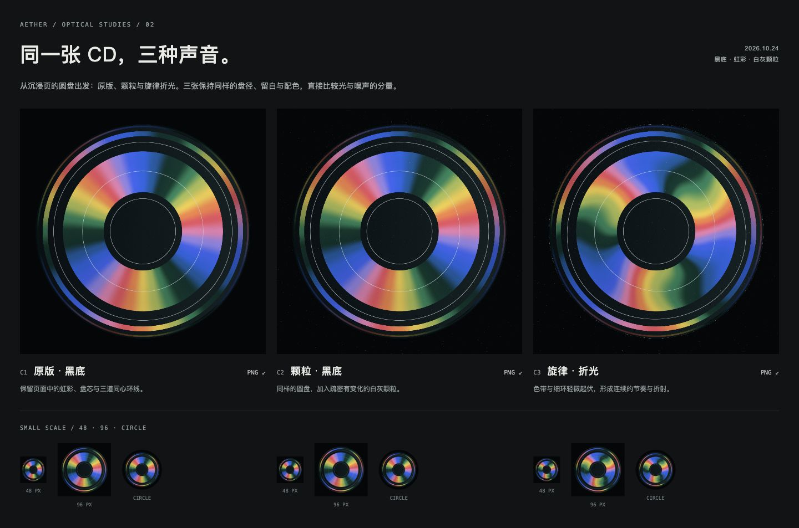

# Aether · CD 黑底对照

2026-10-24。用户提出将沉浸页右上虹彩 CD 单独放入黑底，与图标方向比较；上一条反馈要求黑底中有主 CD 式白灰噪点、旋律感与少量 CD 光学扭曲。本轮沿原有绘制代码制作三个受控对照，未选择最终应用图标。



| 版本 | 改动 | 原图 |
| --- | --- | --- |
| C1 原版 · 黑底 | 原始虹彩 CD 脱离灰蓝组件，独立居中于黑底 | [1024 PNG](exports/01-cd-original.png) |
| C2 颗粒 · 黑底 | C1 上增加固定种子的白灰颗粒，盘缘疏密变化 | [1024 PNG](exports/02-cd-particles.png) |
| C3 旋律 · 折光 | C2 上加入三拍相位起伏，色带与中间细环略微弯曲 | [1024 PNG](exports/03-cd-melodic.png) |

三张均为 1024×1024；黑底 `#050608`，圆盘直径 896px，四边留白 64px。C2、C3 使用完全相同的粒子种子。去掉切台箭头、信息文字与灰蓝组件属于本轮图标提案；没有修改应用里的控件。

## 可编辑源文件

- [原始 CD 着色器](source/disc-original.js)：与 `design/immersive/disc.js` 字节一致，保留其色彩函数、环带和刻线。按原页面旋转 −90°、固定相位渲染。
- [折光着色器](source/disc-optical.js)：独立派生文件，只在频谱相位和刻线半径中加入可控周期起伏。外轮廓和盘芯保持正圆。
- [颗粒与合成](study.js)：Canvas 2D 原生绘制颗粒，叠合 WebGL 圆盘；固定种子 `10424`。
- [比较页](index.html)：三版大图、48/96px 和圆形小样；下方与上一轮黑底棋格／频谱带比较。`?board` 显示三版对照板。
- [输入图及哈希](references/manifest.json)：用户提供的 CD 和颗粒参考原图，未修改。

本轮使用可编辑代码绘制，没有新增 imagegen 调用，也没有编辑上一轮栅格结果。白灰颗粒由可复现的几何点阵构成。PNG 从页面导出链接取得原始字节；`overview.jpg` 是浏览器对照页截图。

## 本地查看

从仓库根目录运行：

```sh
python3 -m http.server 4180 --bind 127.0.0.1 --directory branding/icons
```

打开 `http://127.0.0.1:4180/2026-10-24-cd-black-comparison/index.html`。需要 WebGL2；不可用时明确提示绘制失败，避免输出空白图标。页面静态绘制，没有自动动画。

校验记录见 [verification.json](verification.json)，文件哈希见 [manifest.sha256](manifest.sha256)。本轮仅为图标比较，未接入 Android，也未修改冻结页面。
