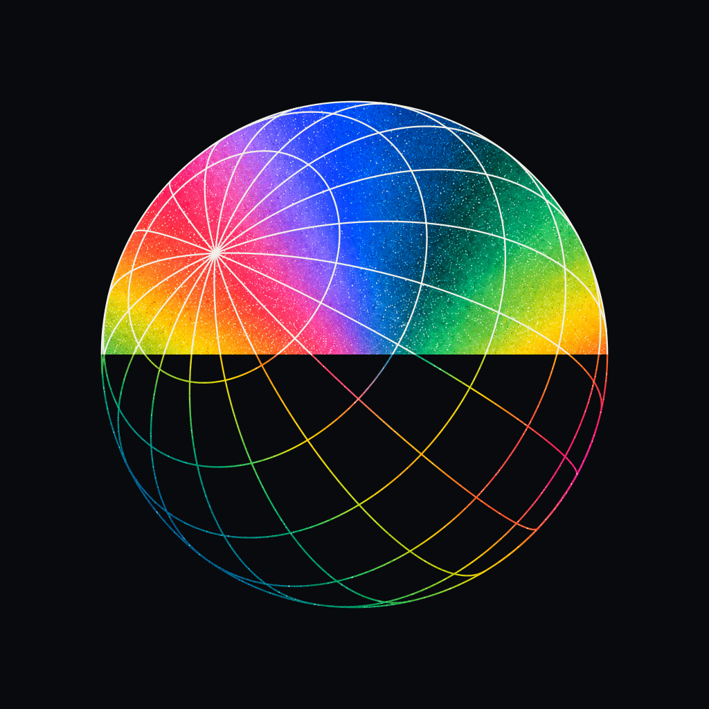

# Aether · 球面结构修复与构图延展

更新：2026-10-25。延续 10 月 24 日开始的图标研究。用户认可 E2 的色彩／平面风格，要求尝试空结构内彩球、黑白球内伸出彩手两个新构图；随后指出 E2 上下两半没有共享同一球面结构。

## E2-v2 · 结构修复

修复使用**一个正交投影球面**，统一球心、半径和轴向。纬线与经线完整生成，SVG 中只有一份 `shared-spherical-grid`；上半和下半均用 `<use>` 引用它，中线只改变色面及线色。

- [纯结构 SVG](shared-structure.svg)／[PNG](exports/shared-structure.png)：25 条完整球面曲线，显示整个结构。
- [彩色修正版 PNG](exports/E2-v2-shared-globe.png)：1024×1024。
- [可编辑结构＋内嵌色域 SVG](E2-v2-shared-globe.svg)：网格为矢量，色域为内置 imagegen 生成的栅格贴图；这是混合资产，不能称为纯矢量。
- [grid.mjs](grid.mjs)／[build.mjs](build.mjs)：投影几何与导出源文件。
- [structure-verification.json](structure-verification.json)：同一份路径引用、正交轴、单位球半径误差及中线交点／切向。证明构造上的连续性，不宣称所有栅格显示的像素完全一致。

辅助色域 `auxiliary/auxiliary-spectrum-field.png` 仅由 imagegen 提供颜料与颗粒，不承担几何。彩面与彩线使用同一色域。原始 E2 在 `references/approved-style.png` 保留，作为风格与错误对照，不再作为结构正确的当前稿。

## F1／F2 · 新构图

| 方向 | 构成 | 文件 |
| --- | --- | --- |
| F1 空结构／内彩球 | 空的灰白球形线框包住内部彩球，黑底与颗粒印刷风格 | [原始 PNG](F1-open-celestial-cage.png) |
| F2 黑白球／彩色伸手 | 黑白球面中，一只彩色手向前伸出；保持五指及遮挡关系 | [原始 PNG](F2-monochrome-globe-spectral-hand.png) |

F1、F2 由内置 imagegen 编辑生成，各 1254×1254，保留原始字节，未做像素后处理。图一为用户认可的风格参考，另外两张分别为天球结构与手势构图参考。它们仍是栅格构图研究；E2-v2 的确定几何验证不扩展为对 F1／F2 的数学正确性声明。

[对照页](index.html)包含原 E2、修正版、纯结构与两个延展；[prompts.md](prompts.md)记录 F1、F2 和辅助色域的三个完整提示词。输入与输出哈希见 [manifest.json](manifest.json)。本轮没有 CLI／API fallback。

## 复现

本机需已安装 `sharp`。运行 `node branding/icons/2026-10-24-globe-structure/build.mjs` 可从共享几何与保存的色域重建修正版及结构图。预览沿用端口 4180、根目录 `branding/icons`，地址 `/2026-10-24-globe-structure/index.html`。

这些仍是图标／视觉提案，尚未选择最终 launcher；未修改两个冻结页面，也未接入 Android。
