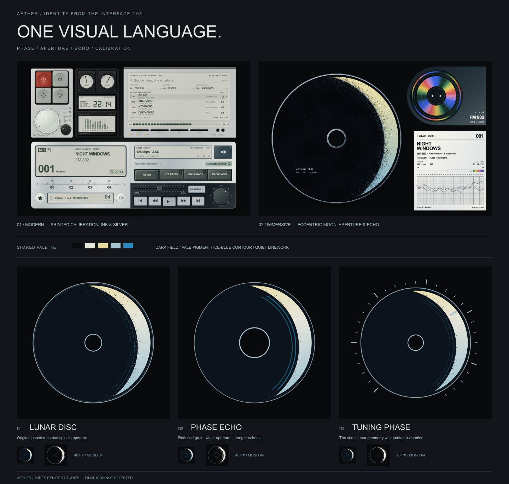

# Aether · 从界面提取的品牌标识

2026-10-24。用户要求将图标的核心元素拉回已有两个页面，避免图标、现代设备页与沉浸页之间产生品牌割裂。本轮以既有界面为唯一造型来源，制作三个可编辑几何提案，并与原页面一起比较。



## 提取关系

| 界面原有元素 | 本轮标识中的作用 | 源码依据 |
| --- | --- | --- |
| 主 CD 的偏心月相 | 主要轮廓与负形 | `design/immersive/disc.js` 的 `printedDisc` |
| 中央盘芯、细圆环 | 保留圆盘识别与同心关系 | 同上，`HOLE=15/120`、collar、rim |
| 相位边界的颗粒、双回声弧 | 沿几何边界组织颗粒；强调相位与频率 | 同上，cutRadius、echo、dust |
| 现代页调谐／音量旋钮的校准刻度 | D3 的仪器式外围印刷 | `design/modern/hardware.js` |
| 默认墨色、银灰、灰白及冰蓝点缀 | 统一底域、线色与局部色域 | 两页已有材质与配色 |

本轮提案让月相承担主识别，虹彩不作为主图标色面。两条回声弧和轮廓保留，外部棋格／丝带等独立构图回到历史探索。这里描述本轮设计取舍，不代表用户已经确认最终标志。

## 三种收敛方式

| 方案 | 几何与用途比较 | 文件 |
| --- | --- | --- |
| D1 月相原盘 | 最接近主 CD；保留较多边界颗粒与原始盘芯比例 | [SVG](icons/D1-lunar-disc.svg) · [PNG](exports/D1-lunar-disc.png) · [单色](mono/D1-lunar-disc.svg) |
| D2 月相回声 | 放大盘芯负形，减少颗粒，加粗双弧；本轮优先深化的设计建议 | [SVG](icons/D2-phase-echo.svg) · [PNG](exports/D2-phase-echo.png) · [单色](mono/D2-phase-echo.svg) |
| D3 调频相位 | 月相结合外围校准与短指示线，连接现代页的仪器语汇 | [SVG](icons/D3-tuning-phase.svg) · [PNG](exports/D3-tuning-phase.png) · [单色](mono/D3-tuning-phase.svg) |

三张是同一品牌几何的变体，不作为三个独立新图标计数。所有方案均未接入 Android，也未修改冻结页面。

## 形状、色彩与小尺寸

月相继承原主 CD 的双圆关系：偏移 `.31R`、切圆 `1.04R`、倾角 `.23rad`，外侧可见月相区域限制为 `.95R`。D1 保留盘芯 `15:120` 的直径比例；D2 放大盘芯是为小图标留出负形的本轮调整。D3 将原页面刻度语言简化成 30 条刻线，是构图提案，并非原页面完整刻度或新的交互规则。

黑色 `#080a0e` 与页面相同，灰白／淡金向冰蓝的过渡为平面色域，线条使用银灰和冰蓝。没有镜面、浮雕或投影。颗粒由固定种子的圆点构成，密度跟随月相边界，均可编辑；单色版本移除颗粒、保留轮廓、负形和回声。

[预览页](index.html)同时显示 48px、96px 与 64px 单色圆形样本。`?board` 显示并置板。小尺寸会减弱细颗粒和刻度，不能仅以高清图中的细节选择最终方案。

## 复现与资产

```sh
node branding/icons/2026-10-24-interface-dna/build.mjs
node branding/icons/2026-10-24-interface-dna/export.mjs
python3 -m http.server 4180 --bind 127.0.0.1 --directory branding/icons
```

打开 `http://127.0.0.1:4180/2026-10-24-interface-dna/index.html`。

- [geometry.mjs](geometry.mjs)：三个方案的完整几何、颗粒与色彩逻辑；[build.mjs](build.mjs)输出 3 张彩色／3 张单色 SVG。
- [export.mjs](export.mjs)：使用本机已安装的 `sharp` 将原生 SVG 导出为 1024px PNG 和页面并置板；[preview.js](preview.js)提供下载及小尺寸比较。本轮没有调用 imagegen。导出脚本需要本机 `sharp` 可解析；当前使用桌面内置依赖。
- `context/`：与冻结包字节一致的现代／沉浸参考图，只用作一致性对照，不属于图标发布文件。
- `references/`：用户当前截图与原字节哈希。`overview.svg`／`overview.png` 是原生矢量排版的页面并置板；页面参考图保持原字节，图标从同一几何源导出。
- [verification.json](verification.json)与[哈希清单](manifest.sha256)：实际文件和浏览器检查记录。

当前交付是品牌视觉提案与静态 SVG／PNG；未进行 Android 启动器适配或终端识别测试，尚无最终图标批准。
