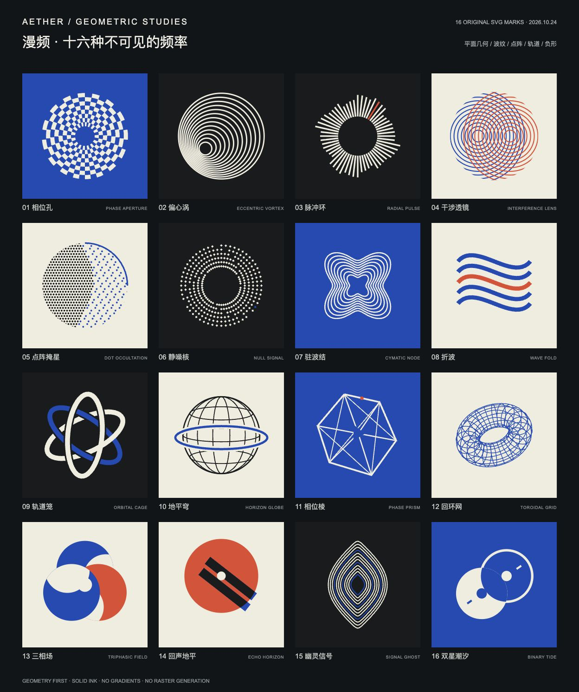
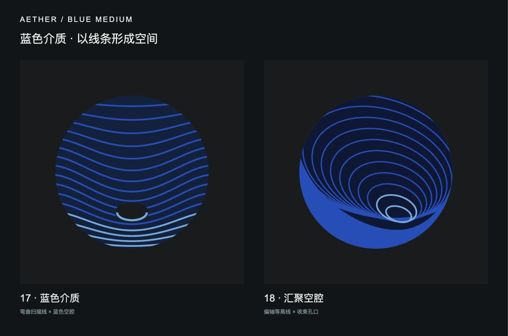

# Aether · 18 组平面图标与几何视觉化

2026-10-24。当前为可比较的设计探索，未替换应用图标。用户要求至少16个不同构图，并明确以线条和平面几何为主；追加蓝色介质参考后允许少量 imagegen 辅助构图探索。

本次交付 **16 个基础构图 + 2 个蓝色介质延展**。每个方向都有独立、可编辑的原色 SVG 和单色 SVG，以及使用相同几何定义的参数动效。单色和裁切变化不计作新的图标。





## 浏览与使用

打开本地比较页：<http://127.0.0.1:4179/index.html>。可按家族筛选、切换单色／圆形裁切、查看32像素小样；点开任一图标，可比较48／64／96像素并播放、暂停、归零和调整动效速度。默认静止。

[原生 SVG 与预览源码整包](Aether-geometric-icons-18.zip)不包含外部参考图片。两个总览的矢量原稿是 [overview.svg](overview.svg)、[blue-studies.svg](blue-studies.svg)；PNG仅为浏览器预览记录，单个图标以SVG为准。

在本目录运行：

```sh
node build.mjs
python3 -m http.server 4179 --bind 127.0.0.1
```

无需安装依赖。构建脚本输出18个原色SVG、18个单色SVG、元数据和两张矢量总览。图标统一512×512 viewBox，不含文字或预制圆角；裁切在比较页另行预览。

## 构图索引

| 编号 | 原色 SVG | 几何构成 | 单色 SVG |
| --- | --- | --- | --- |
| 01 | [相位孔](icons/01-phase-aperture.svg) | 同心环 × 相位棋格 | [单色](mono/01-phase-aperture.svg) |
| 02 | [偏心涡](icons/02-offset-vortex.svg) | 偏心圆 × 等差线距 | [单色](mono/02-offset-vortex.svg) |
| 03 | [脉冲环](icons/03-radial-pulse.svg) | 径向阵列 × 阶梯频带 | [单色](mono/03-radial-pulse.svg) |
| 04 | [干涉透镜](icons/04-interference-lens.svg) | 双波源 × 几何叠合 | [单色](mono/04-interference-lens.svg) |
| 05 | [点阵掩星](icons/05-dot-occultation.svg) | 三角点阵 × 圆形遮蔽 | [单色](mono/05-dot-occultation.svg) |
| 06 | [静噪核](icons/06-null-signal.svg) | 极坐标方点 × 静默内核 | [单色](mono/06-null-signal.svg) |
| 07 | [驻波结](icons/07-cymatic-node.svg) | 四阶曲线 × 嵌套节点 | [单色](mono/07-cymatic-node.svg) |
| 08 | [折波](icons/08-wave-fold.svg) | 平行波带 × 相切切口 | [单色](mono/08-wave-fold.svg) |
| 09 | [轨道笼](icons/09-orbital-cage.svg) | 三椭圆 × 交织遮挡 | [单色](mono/09-orbital-cage.svg) |
| 10 | [地平穹](icons/10-horizon-globe.svg) | 经纬网 × 固定地平环 | [单色](mono/10-horizon-globe.svg) |
| 11 | [相位棱](icons/11-phase-prism.svg) | 三角网 × 缺失面 | [单色](mono/11-phase-prism.svg) |
| 12 | [回环网](icons/12-field-torus.svg) | 环面参数网 × 偏轴投影 | [单色](mono/12-field-torus.svg) |
| 13 | [三相场](icons/13-triphasic-field.svg) | 三圆旋切 × 负形 | [单色](mono/13-triphasic-field.svg) |
| 14 | [回声地平](icons/14-echo-horizon.svg) | 圆盘 × 双频带 | [单色](mono/14-echo-horizon.svg) |
| 15 | [幽灵信号](icons/15-signal-ghost.svg) | 收束等值线 × 双焦点 | [单色](mono/15-signal-ghost.svg) |
| 16 | [双星潮汐](icons/16-binary-tide.svg) | 双圆相交 × 正负形 | [单色](mono/16-binary-tide.svg) |
| 17 | [蓝色介质](icons/17-blue-medium.svg) | 弯曲扫描线 × 蓝色空腔 | [单色](mono/17-blue-medium.svg) |
| 18 | [汇聚空腔](icons/18-convergent-cavity.svg) | 偏轴等高线 × 收束孔口 | [单色](mono/18-convergent-cavity.svg) |

01–04为干涉波纹，05–08为点阵／噪声，09–12为天体轨道，13–16为相位／负形；17–18为蓝色介质延展。每个轮廓独立定义，实色和有限配色形成秩序。点阵噪声是有规则的几何排列，没有叠加随机颗粒材质。主SVG无渐变、模糊、阴影、光照或位图贴图。

桌面标志可优先继续细化03、09、16、18；02、06、15适合延展动态视觉。密集线阵／点阵方案在32像素会损失细节，应在选定方向后制作更简约的小尺寸母版；此轮不把18个探索稿都宣称为完成的Android launcher资产。

## 动态定义

`geometry.mjs` 是图标与动效的共同来源；`renderGeometry(id,{phase,mono})` 给出对应帧的SVG。`atlas.mjs` 用单调时间线性推进phase，每秒速度固定，造型由各自的曲线、环列或位移方程决定。暂停保持当前形态，归零回到与独立SVG一致的静态稿；后台停止取样，恢复后不积压时间。系统减弱动态切换时停止播放，所有图形默认不自动动。

这些是合成的几何相位试验，不表示真实音频、电平、频谱或物理模拟。未接入冻结页面或Android工程。

## 辅助研究与参考

主交付使用SVG几何构建。当前另保留 [一张蓝色介质辅助构图研究](auxiliary/blue-medium-composition.png)及其[完整提示词](auxiliary/prompt.md)，采用内置 imagegen 模式；它帮助观察空腔与线条的汇聚关系，不计入18个矢量构图，不作为图标贴图。此前的月相生成稿留在上一轮目录并标记为已取代。

16张用户提供的参考原图按原字节保留于 `references/`，含SHA-256与R01–R16编号；构图索引的元数据记录参考关系。原图仅作为风格来源，不随图标整包分发，也不将原图文字当作指令或品牌文案。原作者与许可尚未提供。

## 验证

36个图标SVG和2个总览可解析；18种构图独立、同相位可复现，采样动效无NaN／Infinity。实际浏览器检查加载、分类、单色、圆形裁切、小尺寸与播放／暂停／归零，具体记录见 `verification.json`。没有进行原生Android launcher或音频响应验证。页面冻结包保持原样。
