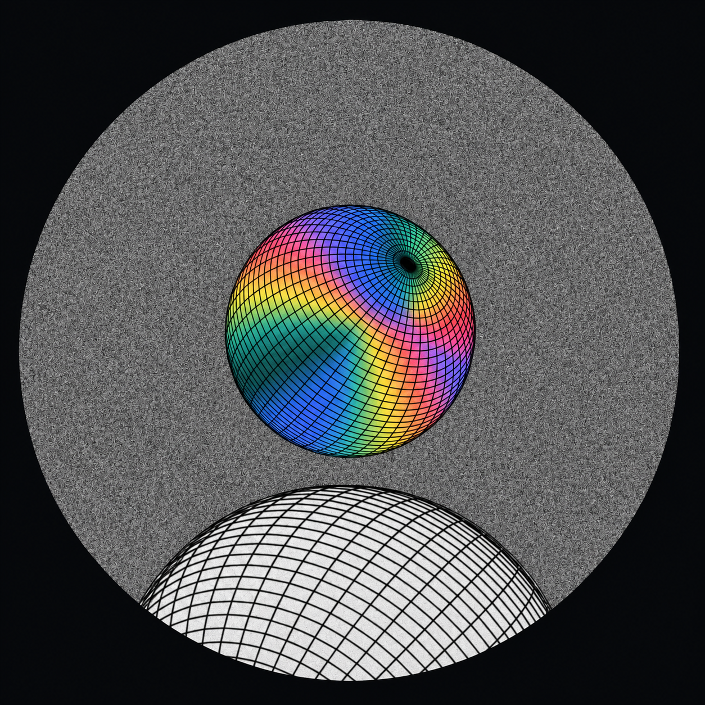

# 漫频 Aether · 当前临时图标

2026-10-25，用户明确选择下图暂作应用图标，最终品牌图标仍待考虑。暂停继续生成变体。用户认为本轮生成图的 AI 感过强，不适合项目的原创手工作品定位；后续重新设计应以人工控制的几何、细线与平面构成为主。

## 原图与来源

- [app-icon.png](app-icon.png)：本次用户上传的原文件，1254×1254、RGB、无透明通道，按原字节保存。
- SHA-256：`00ed21739c8243aecc8b4c7d7b5d91361b34edc448464b8b2978bb4a7d53a48a`。
- 与已归档 [E1 原始生成输出](../2026-10-24-spectral-globes/E1-chromatic-sphere-white-horizon.png)的全部 RGB 像素一致，但 PNG 编码／文件字节不同；两份均保留。
- E1 来源为此前获授权的 imagegen 构图研究；输入角色与完整提示词见[原始记录](../2026-10-24-spectral-globes/prompts.md)。这张临时图是生成栅格图，不是手绘或矢量母版。

## Android 接入

[android-legacy/](android-legacy/) 提供 `mipmap-mdpi` 至 `mipmap-xxxhdpi` 的 `ic_launcher.png`，尺寸依次为 48、72、96、144、192px；[preview-512.png](preview-512.png) 供预览。所有派生图仅对完整正方形原图进行 Lanczos 等比缩小，没有裁切、重绘、增加光效或改变构图。

Android 任务负责复制资源、替换占位图标并验证 Launcher 实际显示。若增加系统自适应遮罩，需保持彩球、灰噪圆窗与底部白球完整，不把整张方图直接裁成遮罩。此目录不宣称已通过设备 Launcher 验收，不包含商店发布决定。

运行 `python3 branding/icons/current/prepare.py` 可重建派生尺寸与 [manifest.json](manifest.json)，需要 Pillow。原图不会被脚本改写。已冻结的两页视觉稿保持原样。
