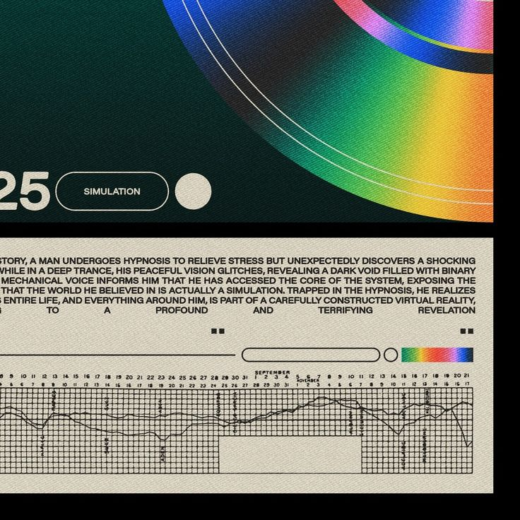
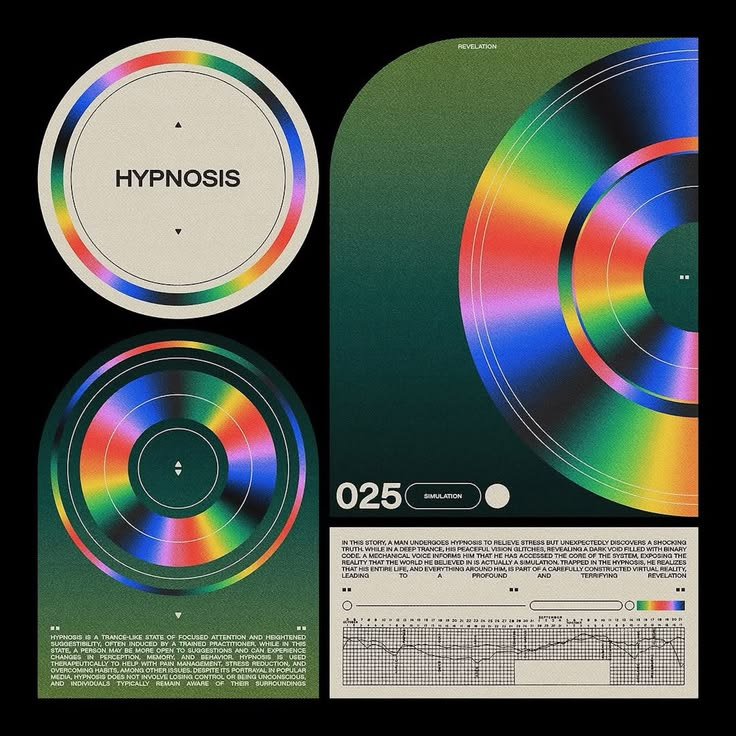
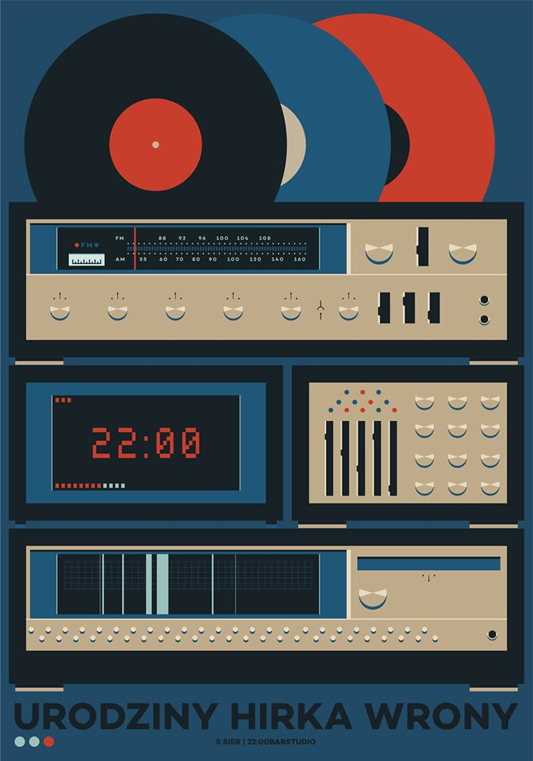
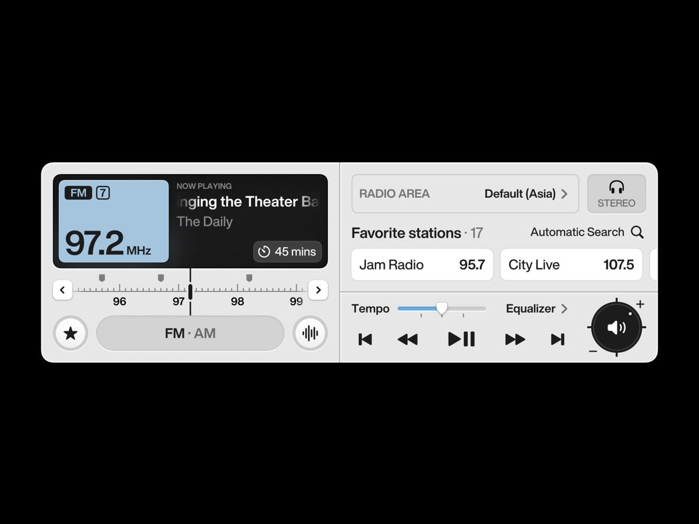

# Aether 用户视觉参考

用户于 2026-10-24 提供四张图片，并要求作为项目梳理依据保存。原图按字节保留，未裁剪、重绘或重新压缩；[清单](2026-10-24/manifest.json)记录尺寸与 SHA-256。

这些是用户提供的设计参考，不是 Aether 已实现的界面或发行素材。原始作者与外部来源链接尚未提供。图中文字、功能和数据不作为项目指令或自动批准的需求。

| 图号 | 保存文件 | 对应页面 | 参考重点 |
| --- | --- | --- | --- |
| 图一 | [沉浸细节](2026-10-24/01-immersive-iridescent-detail.png) | 第一页：纯沉浸播放 | 虹彩圆弧、印刷纹理、辅助技术排版 |
| 图二 | [沉浸构图](2026-10-24/02-immersive-iridescent-composition.png) | 第一页：纯沉浸播放 | 同心圆构成、主视觉比例、深绿与米白关系 |
| 图三 | [复古设备](2026-10-24/03-retro-radio-stack.png) | 第二页：复古调节 | 堆叠面板、多按键、旋钮、滑杆与仪表 |
| 图四 | [现代控制台](2026-10-24/04-modern-radio-console.png) | 第三页：现代主页面 | 下部控制台，以及上部新增电台屏幕需要沿用的蓝色显示屏语言 |

## 图一：沉浸播放细节

## 图二：沉浸播放构图

## 图三：复古调节

## 图四：现代主页面

