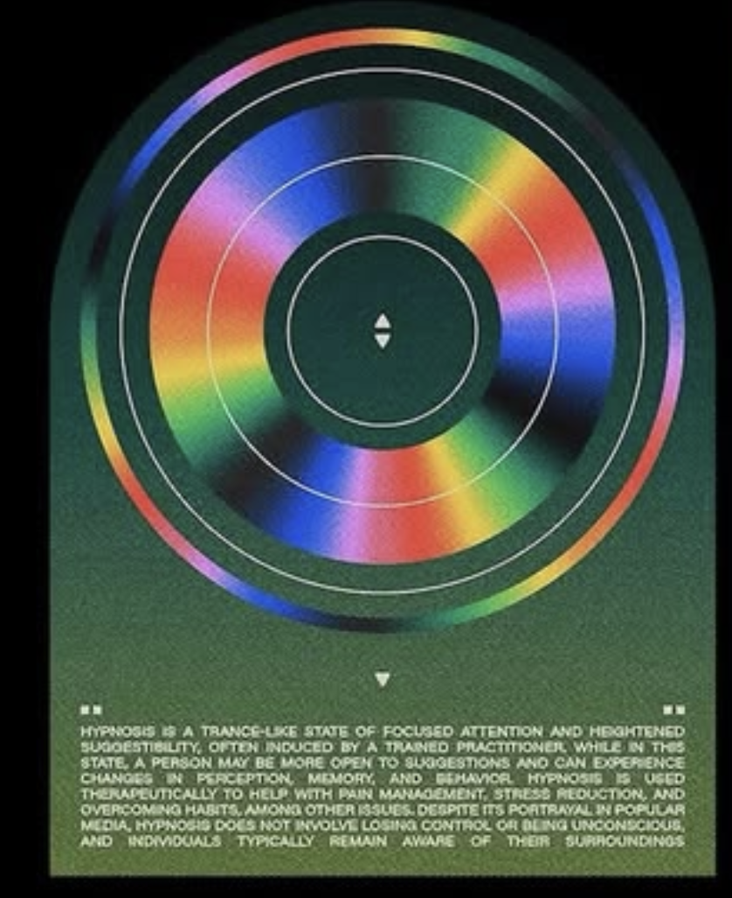
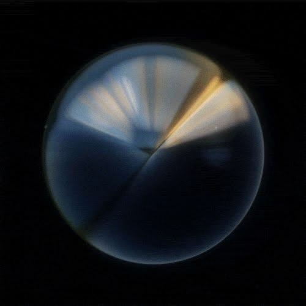
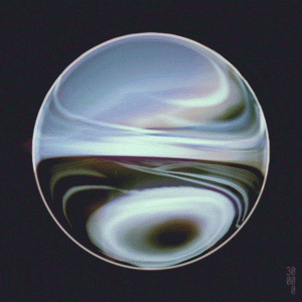
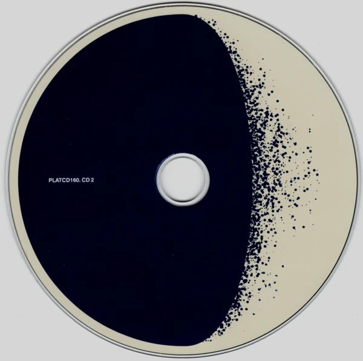
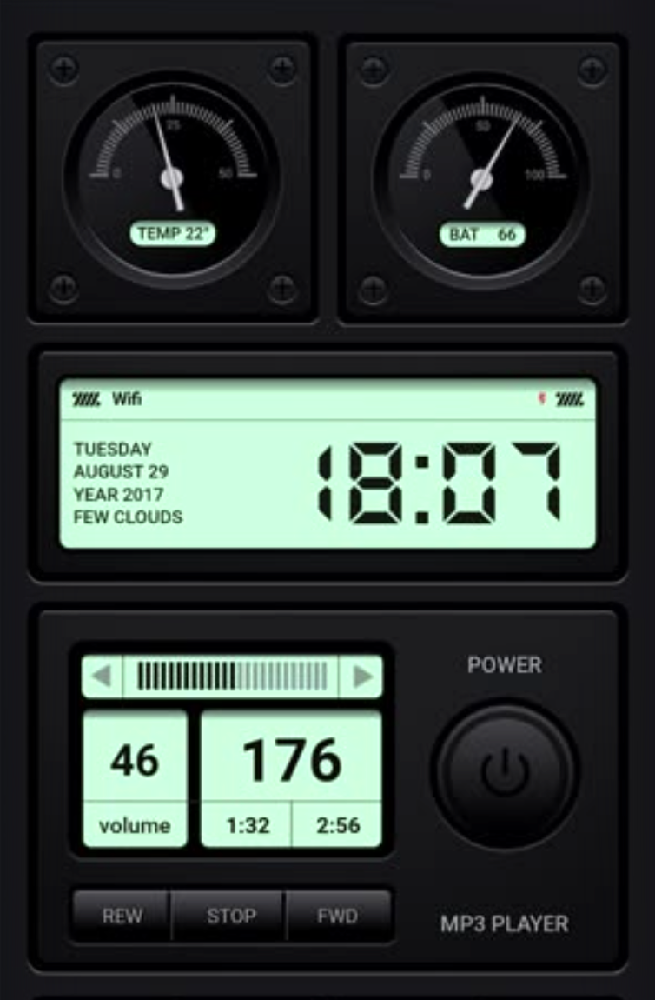
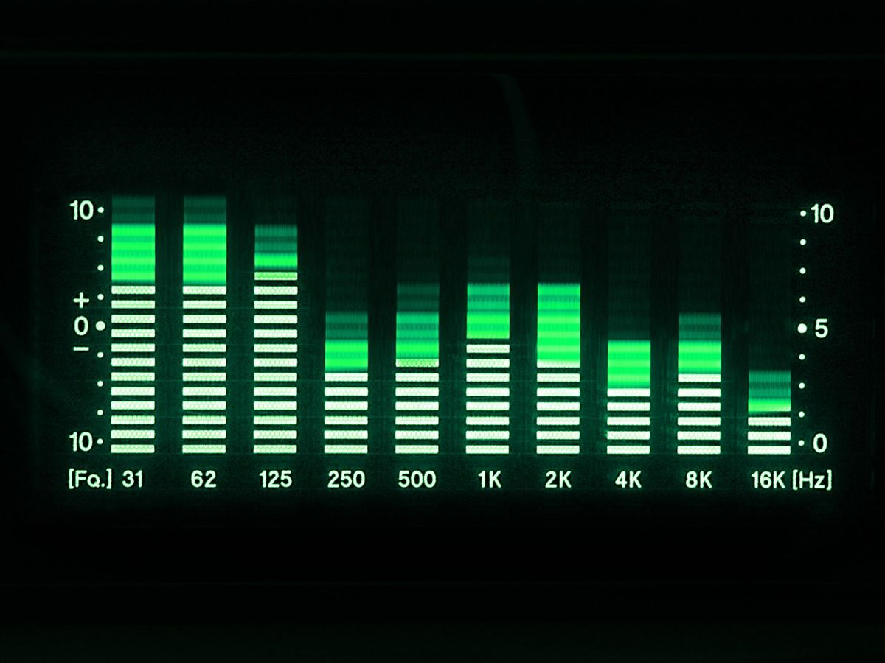
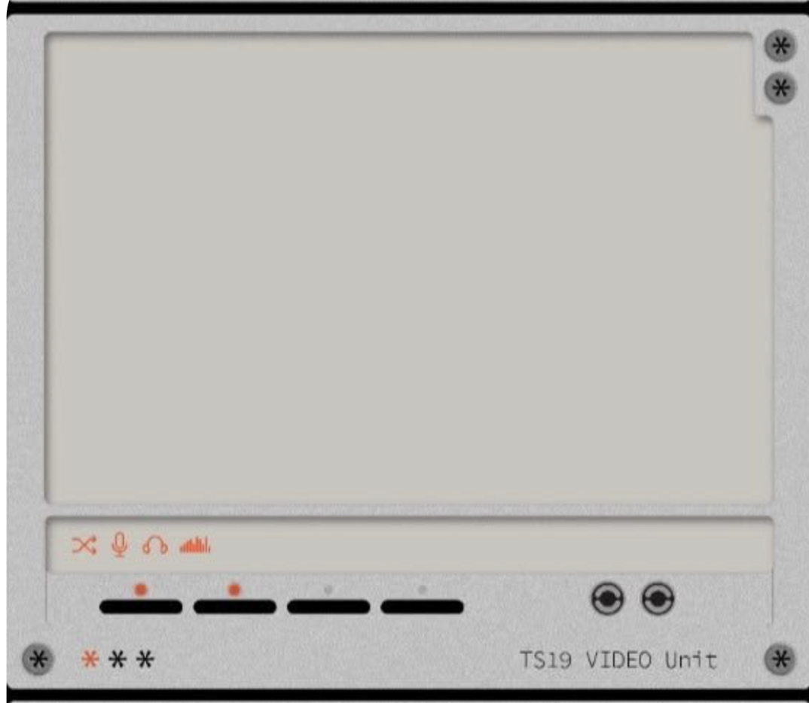

# Aether 用户视觉参考

用户于 2026-10-24 提供四张初始图片，随后补充绿色组件局部图、两张光学材质参考及印刷 CD 参考，并要求作为项目梳理依据保存。原图按字节保留，未裁剪、重绘或重新压缩；[清单](2026-10-24/manifest.json)记录尺寸与 SHA-256。用于标出问题的应用截图不混入艺术参考归档。

当前只实现现代与沉浸两页；表内“第二页／第三页”保留最初图号语境，复古方向已撤出本轮建设。

这些是用户提供的设计参考，不是 Aether 已实现的界面或发行素材。原始作者与外部来源链接尚未提供。图中文字、功能和数据不作为项目指令或自动批准的需求。

| 图号 | 保存文件 | 对应页面 | 参考重点 |
| --- | --- | --- | --- |
| 图一 | [沉浸细节](2026-10-24/01-immersive-iridescent-detail.png) | 第一页：纯沉浸播放 | 虹彩圆弧、印刷纹理、辅助技术排版 |
| 图二 | [沉浸构图](2026-10-24/02-immersive-iridescent-composition.png) | 第一页：纯沉浸播放 | 同心圆构成、主视觉比例、深绿与米白关系 |
| 图三 | [复古设备](2026-10-24/03-retro-radio-stack.png) | 第二页：复古调节 | 堆叠面板、多按键、旋钮、滑杆与仪表 |
| 图四 | [现代控制台](2026-10-24/04-modern-radio-console.png) | 第三页：现代主页面 | 下部控制台，以及上部新增电台屏幕需要沿用的蓝色显示屏语言 |
| 后补图五 | [绿色切台组件细节](2026-10-24/05-immersive-green-selector-detail.png) | 第一页右上 | 用户确认逆时针旋转 90° 的横向构成，替代早期米白标题盘；参考连续渐变与三角切台 |
| 后补图六 | [光学反射](2026-10-24/06-immersive-optical-reflection.png) | 第一页主 CD | 银蓝反光、折射边缘与暖金衍射光束 |
| 后补图七 | [液态折射](2026-10-24/07-immersive-liquid-refraction.png) | 第一页主 CD | 弯曲高光、玻璃与液态金属质感 |
| 后补图八 | [印刷艺术 CD](2026-10-24/08-immersive-printed-dissolution-cd.png) | 第一页主 CD 前期参考 | 奶油底、偏心靛蓝墨面、向右消散的颗粒与金属薄边 |

## 图一：沉浸播放细节

## 图二：沉浸播放构图

## 图三：复古调节

## 图四：现代主页面

## 后补图五：沉浸页右上绿色切台组件

## 后补图六／七：主 CD 光学材质

## 后补图八：主 CD 前期印刷参考

## 现代页新增参考（本轮图一至图四）

本轮图一与初始图四同一控制台方向，独立原样保存；下表使用累计归档图号避免混淆。

| 归档图号 | 本轮图号 | 文件 | 对应位置 |
| --- | --- | --- | --- |
| 九 | 一 | [银灰控制台](2026-10-24/09-modern-console-detail.png) | 底部，占长边至少 85% |
| 十 | 二 | [深色仪表与屏幕](2026-10-24/10-modern-instrument-rack.png) | 上方左对齐 |
| 十一 | 三 | [绿色分段频谱](2026-10-24/11-modern-green-spectrum.png) | 嵌入左上组件 |
| 十二 | 四 | [银灰大屏机壳](2026-10-24/12-modern-large-display.png) | 上方右对齐（本地解释） |

## 现代页实体控制补充参考

| 图号 | 文件 | 参考重点 |
| --- | --- | --- |
| 十三 | [实体键帽](2026-10-24/13-modern-physical-keycaps.png) | 方形底座、圆形键面、按压与微光；重建为四枚无文字图标键 |
| 十四 | [大小旋钮](2026-10-24/14-modern-tuning-and-volume-dials.png) | 白色大轮、周围刻度、右下黑色小控件；不沿用其耳机图标 |
